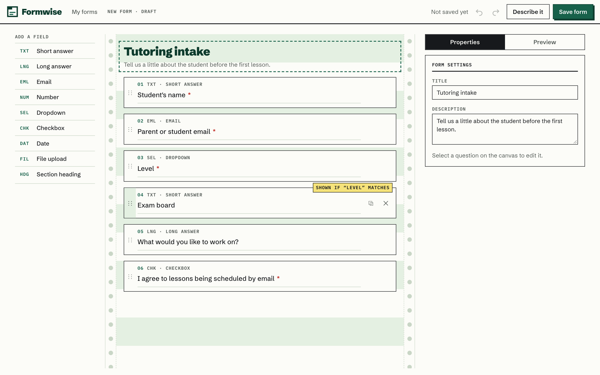
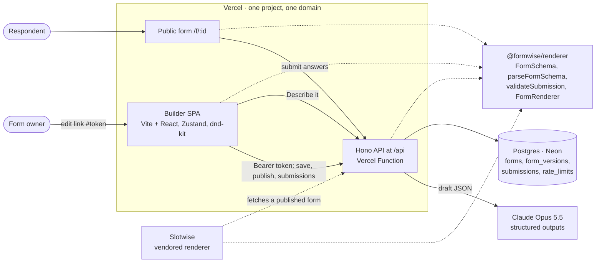

# Formwise

A drag-and-drop form builder. Build a form from a palette of field types, set validation and show-if conditions, and see it live in the real renderer. The form is stored as a versioned, Zod-validated JSON schema.

The renderer is a separate package (`@formwise/renderer`). It also powers the intake form in [Slotwise](https://github.com/krishnanbhupathi/slotwise-booking), the companion booking tool.

**Live:** https://formwise-builder.vercel.app. It also powers the intake questions on [Slotwise](https://slotwise-booking-xi.vercel.app/book/demo-tutor/a-level-physics). Status and decisions: [PROGRESS.md](PROGRESS.md).

**Walkthrough video (93 s, narrated):** https://videos.bhupathi.dev/case-studies/formwise.mp4



## Measured
Figures from production, with the raw data in [`docs/measurements`](docs/measurements).

| | Result |
|---|---|
| Lighthouse, builder (mobile / desktop) | Performance 98 / 100, Accessibility 100 / 100, Best practices 100, SEO 100. Mobile LCP 1.8 s |
| Lighthouse, public form (mobile / desktop) | Performance 99 / 100, Accessibility 100 / 100, Best practices 100. SEO 63 on purpose: `robots.txt` keeps shared forms out of search |
| "Describe your form", Claude Opus 5.5 | 8 of 8 descriptions gave a valid form. End to end from India to the US region: median 4.45 s, range 2.91–7.67 s |
| Same 8 descriptions, Claude Haiku 5.5 (before the switch) | 8 of 8 valid. End to end median 2.22 s; server-side median 1.94 s over 9 calls; about 1,700 input and 220–484 output tokens per call |
| Tests | 140 Vitest + 16 Playwright runs (15 pass, 1 skipped by design), green in CI |

Lighthouse is the median of 3 runs with Lighthouse 12.8.2's default throttling ([summary](docs/measurements/lighthouse-2026-10-14-green-bar/SUMMARY.md)). AI timings are in [`ai-opus-2026-10-15.md`](docs/measurements/ai-opus-2026-10-15.md) and [`ai-2026-10-15.md`](docs/measurements/ai-2026-10-15.md).

## What works today
- **Palette → canvas:** drag a field type onto the canvas, or click it to insert it after the selected question.
- **Reorder:** drag by the handle, or use the keyboard (Tab to the handle, Space, arrow keys, Space). Screen readers hear question names, not ids.
- **Properties panel:**
  - Label, help text, required.
  - Per-type settings: length limits, number range and whole-number rule, date range, accepted file types and size, and dropdown options (add, rename, reorder, remove).
  - Show-if conditions.
- **Live preview:** the real `<FormRenderer>`, with inline validation. "Test submit" shows the exact data a submission would store.
- **Field types:** short and long answer, email, number, dropdown, checkbox, date, file, section heading.
- **Undo/redo:** toolbar buttons, Cmd/Ctrl+Z, and Shift+Cmd/Ctrl+Z (or Ctrl+Y). Typing in a property is one step, not one per keystroke, and undo brings back a condition that a move or deletion removed.
- **Save, publish, share:**
  - Saving gives a private edit link; there are no accounts.
  - Drafts autosave.
  - Publish freezes a numbered version, and the public link `/f/<id>` serves it.
  - Edits stay private until you publish again.
- **Submissions:** the server validates each submission with the same code as the browser. The owner sees a table and can export CSV.
- **Describe your form:** Claude Opus 5.5 drafts the questions, types and conditions from a sentence or two. The draft replaces the canvas in one undoable step.

## Design
The look is **green-bar form paper**, the striped continuous paper offices printed forms and ledgers on. The builder looks like the thing it makes.
- **Printed boxes:** each question is a square box with a numbered corner label and a type code (`01 TXT · SHORT ANSWER`). The public form uses the same numbering.
- **Colour has one job each:** green means you can act; a canary "carbon" tag marks a question that depends on another answer; red is only for required marks, errors and the "Published v3" rubber stamp.
- **Type:** Schibsted Grotesk for headings and UI, IBM Plex Mono for field numbers and codes. Both are self-hosted, so pages make no third-party requests.
- Light only, because it's paper.

## How it's built



The renderer package is the shared core: the builder's preview, the public form, the API and Slotwise all validate with the same `parseFormSchema` and `validateSubmission`, so a form can't pass in one place and fail in another. Dashed arrows are code imports; solid arrows are requests.

```
packages/renderer   @formwise/renderer: schema (Zod), validation, <FormRenderer>, styles.css
                    (@formwise/renderer/core = schema + validation without React)
apps/builder        Vite + React SPA: Zustand store, dnd-kit canvas, Tailwind
apps/api            Hono API + Drizzle (Postgres); local server or Vercel Functions
api/                Vercel entry that mounts the Hono app at /api
e2e/                Playwright tests against the production build + real API + Postgres
```

**One schema, many readers.** The builder, preview, renderer and export all read the same `FormSchema`. `parseFormSchema` is the gate for anything untrusted (imports, API bodies, AI output). It checks:
- unique ids;
- min ≤ max;
- conditions point only at an *earlier* dropdown, checkbox or short-answer field (which rules out cycles);
- a dropdown condition names an option that exists.

Every exported form carries `version`, and a migration registry upgrades old forms before they're validated.

**Every edit is a command.** The UI never mutates the form directly. It dispatches commands such as `addField`, `moveField` and `updateField` to a pure `applyCommand(form, command)` reducer built with Immer, so unchanged parts keep their identity. This makes edits unit-testable and gives undo/redo a single place to record history.

**Conditions stay valid automatically.** A move, deletion or option removal can break a condition. When that happens, the reducer removes the broken condition and the UI says which question lost it. Rejecting the change instead would make dragging feel broken. A property test applies 300 random edits and checks the schema stays valid after each one.

**Hidden means hidden.** When a field's condition isn't met, `validateSubmission` skips the field and drops its answer. A hidden required question never blocks submission, and stale answers are never stored. Select answers are stored as the option label; conditions match by option id, so renaming an option doesn't break them.

**Undo is snapshots, not inverse commands.** Immer shares every unchanged part of the form, so a snapshot costs little more than what changed, and restoring one can't drift the way hand-written inverses can. Keystrokes that edit the same property within one second merge into a single step (capped at 100 steps).

**Owning a form without accounts:**
- Saving creates a 256-bit edit token. The server stores only its SHA-256 hash and compares tokens in constant time.
- The edit link carries the token in the URL fragment (`/edit/<id>#<token>`), which browsers never send to servers or put in Referer headers.
- The app sends it as a Bearer header. This browser also remembers it, for "My forms".

**Drafts vs. published versions:**
- Autosave sends the draft with the revision it was based on. A stale save gets a 409 and stops autosave, so a second tab can't silently overwrite the first.
- Publish freezes the saved revision as version N.
- Each submission records its version and is validated against that version on the server. Publishing while someone is mid-form doesn't reject their answers.
- The submissions table keeps columns for questions that later versions removed.

**Public endpoint hygiene:**
- 256 KB body limit.
- A honeypot field; caught bots get a fake success so they don't adapt.
- A per-IP, per-form fixed-window rate limit in Postgres, keyed by a hashed IP, never the address.
- The CSV is built in the browser, so the token never goes in a URL. Cells starting with `= + - @` are escaped against spreadsheet formula injection.

**AI output is checked like any other untrusted input:**
- The model fills in a small *draft* format using structured outputs (a JSON schema): readable keys, option text, conditions by key. Length and range limits that structured outputs can't express are still enforced afterwards by the full Zod schema.
- The server turns the draft into a real schema with ids and runs `parseFormSchema`. If that fails, the exact errors go back to the model once.
- Abuse limits: descriptions of 10–1000 characters, a per-IP rate limit, and a daily cap.
- Each call logs its duration and token counts.
- Tests and local e2e use a deterministic fake model, so CI spends nothing.

**Embeddable in other apps.**
- `<FormRenderer>` is a complete form.
- `<FormFields>` is just the questions, for hosts that already have a `<form>`. Slotwise uses this inside its booking form and checks the answers on its server with `@formwise/renderer/core`.

**File fields record metadata only.** Name, size and type are checked against the field's rules; there's no file storage in this MVP.

### Trade-offs
| Choice | Why | Cost |
|---|---|---|
| Vite SPA + small API (not Next.js) | The builder is entirely client-side; this keeps it simple and fast | Two deploy targets once the API lands |
| `@dnd-kit/core` + `sortable` (stable) | Mature keyboard sensor and screen-reader announcements | `@dnd-kit/react` is the future API but still 0.x |
| Renderer styled with plain CSS + `--fw-*` variables | Works in hosts without Tailwind (e.g. Slotwise); themable | A second styling approach alongside Tailwind |
| Inspector tabs (Properties / Preview) | Fits a laptop screen next to the canvas | Preview and properties aren't visible at the same time |
| Secret edit links instead of accounts | No sign-up, so a demo takes seconds | Lose the link and you lose access; no "my forms" across devices |
| Hono inside the same Vercel project | One domain, no CORS, one deploy | API and SPA deploy together |
| Rate limit in Postgres | No extra service (Redis/KV) | One upsert per public request; not an edge-level defence |
| Hand-written 4-route router | No dependency for pathname + pushState | Would swap for a router library as routes grow |
| Claude Opus 5.5 for "Describe your form" (`FORMWISE_AI_MODEL` overrides it) | Haiku duplicated a question to fake an "is one of" condition; Opus didn't | About twice as slow end to end (median 4.45 s vs 2.22 s) |

## Run it

```bash
npm install
cp .env.example .env.local   # set DATABASE_URL (e.g. postgres://localhost/formwise)
npm run db:migrate
npm run dev          # API on :8787 + builder on http://localhost:5173 (proxies /api)
npm test             # Vitest (unit + component)
npm run e2e          # Playwright, desktop + Pixel 7; needs a formwise_e2e database (E2E_DATABASE_URL)
npm run typecheck && npm run lint
```

## Tests
- **140 Vitest tests** in total (39 renderer, 65 builder, 36 API).
- **Renderer and builder** cover:
  - schema rules and versioning;
  - validation, including conditional and hidden fields, files and numbers;
  - `<FormRenderer>` and `<FormFields>`;
  - the command reducer, with a 300-step random-edit property test;
  - undo/redo history and its shortcuts;
  - the autosave controller;
  - CSV and the router.
- **The 36 API tests** run against PGlite (Postgres compiled to WASM) and cover:
  - edit-token auth;
  - optimistic locking;
  - publishing;
  - server-side validation against old versions;
  - the honeypot and rate limits;
  - pagination;
  - AI draft conversion, retry (including non-JSON answers), the structured-output schema and endpoint limits.
- **16 Playwright runs (15 pass, 1 skipped)** on desktop Chrome and Pixel 7, against the production build, the real API and Postgres. They cover:
  - building with mouse and keyboard;
  - conditions and undo;
  - describe-your-form (fake model);
  - save → publish → fill → read and export submissions;
  - edit links in a fresh browser;
  - a stale second tab.

  The mouse-drag test is skipped on mobile. The suite also runs against production: `E2E_BASE_URL=https://formwise-builder.vercel.app npm run e2e`.

## Known limitations
- Conditions only support "equals one value". "Is one of" is the natural next step; without it, a question shown for several answers can't be expressed.
- File fields record name, size and type only. There's no file storage.
- AI drafts vary between runs. In one measured run the model returned 4 questions for a description that asked for 6; a rerun returned all 6. The draft is always validated, and undo restores the previous form.
- No accounts: losing the edit link means losing access to the form.
